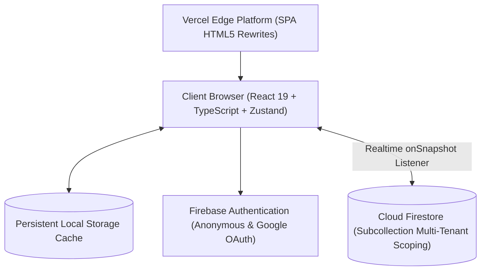

# StudyFlow — Deadlines, Timetable, Focus Timer & GPA What-If

[](https://app-beta-lilac-23.vercel.app)
[](https://app-beta-lilac-23.vercel.app)
[](https://react.dev)
[](https://www.typescriptlang.org)
[](https://tailwindcss.com)
[](https://firebase.google.com)
[](https://vitest.dev)

StudyFlow is a study planner for university students: assignments with subtasks, a weekly timetable, a Pomodoro focus timer with ambient sounds, a projected-GPA what-if calculator, and JSON backup/restore.

🔗 **Live Production URL**: [https://app-beta-lilac-23.vercel.app](https://app-beta-lilac-23.vercel.app)

---

## 📖 Table of Contents
- [About The Project](#-about-the-project)
- [System Architecture](#-system-architecture)
- [Key Features](#-key-features)
- [Technology Stack](#-technology-stack)
- [Getting Started](#-getting-started)
- [Testing & Quality Assurance](#-testing--quality-assurance)
- [Security & Multi-Tenant Isolation](#-security--multi-tenant-isolation)
- [Implementation Roadmap](#-implementation-roadmap)
- [Team & Governance](#-team--governance)

---

## 🎯 About The Project

University students routinely juggle complex syllabi, overlapping course deadlines, and fragmented study habits. StudyFlow provides a cohesive, single-window academic workspace designed with human-computer interaction (HCI) principles:
- **Low Cognitive Overhead**: Clean visual hierarchy that surfaces urgent obligations without artificial badges or high-stress neon pills.
- **Dual-Token Theme**: High-contrast paper palette for daylight library study and true dark obsidian slate for late-night focus sessions.
- **Timestamp-Anchored Timer**: Remaining time is recomputed from timestamps when the tab regains focus. Alerts do not fire while the device is asleep.
- **Dynamic GPA Simulator**: Course-weighted quality points calculation with a what-if solver computing exact needed exam percentages to secure target honors tiers.
- **Client-First Disaster Recovery**: JSON export and schema-validated import with prototype-pollution checks.

---

## 🏗️ System Architecture



---

## ✨ Key Features

1. **Today**: Upcoming deadlines, focus time, and a projected GPA.
2. **Coursework & Deliverables Tracker**: Comprehensive task management with subtask state machines, priority tiers, course code tags, and automatic progress calculation capped at 99% until fully verified.
3. **Weekly Academic Timetable**: Interactive schedule grid supporting lecture sessions, labs, review blocks, and exam periods with full quick-add modals and iCal ICS export.
4. **Deep Focus Timer & Soundscapes**: Configurable Pomodoro engine (Focus, Short Break, Long Break) paired with Web Audio API generative soundscapes (Rain, Brown noise, White noise, Binaural alpha beats).
5. **Academic Grades & What-If Simulator**: Standard 4.0 GPA calculation weighted by course credit hours. Includes an interactive solver that computes the exact final exam score needed to achieve target grades.
6. **Data Portability & Security**: Offline disaster recovery JSON backup with strict validation against prototype pollution and resource exhaustion.

---

## 💻 Technology Stack

- **Frontend Core**: [React 19](https://react.dev), [TypeScript 7](https://www.typescriptlang.org), [Vite 8](https://vitejs.dev)
- **Styling & UI**: [Tailwind CSS 3.4](https://tailwindcss.com), [Lucide React](https://lucide.dev)
- **State Management**: [Zustand 5](https://zustand-demo.pmnd.rs) with persistent local storage middleware
- **Backend & Cloud Sync**: [Firebase 13](https://firebase.google.com) (Authentication + Cloud Firestore)
- **Automated Testing**: [Vitest 5.1](https://vitest.dev)
- **Hosting & Edge Routing**: [Vercel](https://vercel.com) Edge Platform

---

## 🚀 Getting Started

### Prerequisites
- Node.js `v20.x` or higher
- npm `v10.x` or higher

### Local Development Setup

1. **Clone the repository**:
   ```bash
   git clone https://github.com/j-derek/studyflow.git
   cd studyflow/app
   ```

2. **Install dependencies**:
   ```bash
   npm install
   ```

3. **Configure Environment Variables**:
   Create a `.env.local` file with your Firebase configuration:
   ```env
   VITE_FIREBASE_API_KEY=your-api-key
   VITE_FIREBASE_AUTH_DOMAIN=your-project.firebaseapp.com
   VITE_FIREBASE_PROJECT_ID=your-project-id
   VITE_FIREBASE_STORAGE_BUCKET=your-project.appspot.com
   VITE_FIREBASE_MESSAGING_SENDER_ID=your-sender-id
   VITE_FIREBASE_APP_ID=your-app-id
   ```

4. **Launch development server**:
   ```bash
   npm run dev
   ```
   Open `http://localhost:5173` in your browser.

5. **Production Build**:
   ```bash
   npm run build
   ```

---

## 🧪 Testing & Quality Assurance

All commands run from `app/`. CI (`.github/workflows/ci.yml`) runs the first four on every push.

| Command | What it proves | Needs |
|---|---|---|
| `npm test` | Unit tests: GPA (integer maths, property tests), subtasks, timer engine, `.ics` export round-tripped through a real parser across the 2026 New York daylight-saving changes, deadline maths, backup import with hostile input, Firestore mappers, late-snapshot race | Node |
| `npm run test:rules` | Firestore security rules against the emulator: tenancy, field shape, NaN, string limits, server-time rules, list caps, timer revision compare-and-swap (two clients, one wins), forged focus sessions | Java |
| `npm run test:e2e` | Playwright against the Auth + Firestore emulators: account switching and sign-out leave nothing behind (DOM, localStorage, IndexedDB, Cache Storage), guest-to-Google merge, timer survives refresh and syncs across tabs, grades sync, axe-core on every screen in light/dark and desktop/mobile, dialogs, keyboard-only walks, no horizontal scrolling at 320 to 1440 px | Java, Chromium (`npx playwright install chromium`) |
| `npm run build` | Type-check and production build | Node |

### What is not covered
- No real screen reader (NVDA, VoiceOver) has been run; axe cannot judge reading order or meaning.
- Google sign-in is tested against the Auth emulator's fake popup, not Google.
- Firestore rules have not been deployed to the real project from this branch (see Deploying).

---

## 🔒 Security & Multi-Tenant Isolation

- **Tenancy**: all data lives under `/users/{userId}/` and every rule checks `request.auth.uid == userId`. Everything else is denied.
- **Field shape**: every collection lists its allowed keys, types and string limits (measured in UTF-16 units, so an emoji counts as 2). Timestamps that matter (`updatedAt`, timer start, session completion) must be server time.
- **Focus sessions** can only be created in the same batch that stops a running timer, with an id tied to the timer revision, and only after enough server time has passed. They cannot be edited.
- **Timer** writes carry a revision number that must rise by exactly one, so two devices cannot both win.
- **Sign-out and account switch** remove listeners, the in-memory store, localStorage, sessionStorage, Cache Storage and the Firestore IndexedDB cache, then reload.
- **Backups**: files over 5 MB, duplicate ids, unknown keys, bad times and `__proto__` style keys are rejected; at most 500 assignments (the same cap as the database list queries).
- No compliance claim is made. Passing automated checks is not the same as being WCAG-conformant or secure against every attack.

### Deploying
Firestore rules and indexes deploy from this repository with the Firebase CLI in CI (job `deploy-rules`, `main` only, needs a `FIREBASE_SERVICE_ACCOUNT` secret). Never paste rules into the console. Ship the app version first, then the rules.

---

## 🗺️ Implementation Roadmap

- [x] **Phase 1: Production MVP** — Deployed live on Vercel.
- [x] **Phase 2: UI/UX Audit & Anti-Slop Redesign** — plain copy, no invented statistics, honest status indicators.
- [x] **Phase 3: Front-End Remediations** — editable profile, week-switching timetable, what-if calculator, responsive navigation.
- [x] **Phase 4A: Backend Hardening & Automated Test Suites** — rules emulator suite, account-isolation suite, pure-logic suites, timer refactor, CI. *Open:* the new rules are not yet deployed to the real Firebase project.
- [ ] **Phase 4B: Vercel preview (4B-1) and production domain (4B-2)** — preview deploys work and routing is verified there; no custom domain bound yet.
- [x] **Phase 4C: Accessibility and performance** (automated part) — axe-core clean, keyboard and dialog tests, Lighthouse mobile run. *Open:* manual screen-reader pass.
- [x] **Phase 5: GitHub Push & Release Tagging** — [github.com/J-Derek/studyflow](https://github.com/J-Derek/studyflow).
- [ ] **Five-student usability test** — needs the product owner to arrange it.

---

## 👥 Team & Governance

- **Product Owner**: 21
- **Built with AI coding assistants; every change is reviewed by the product owner
