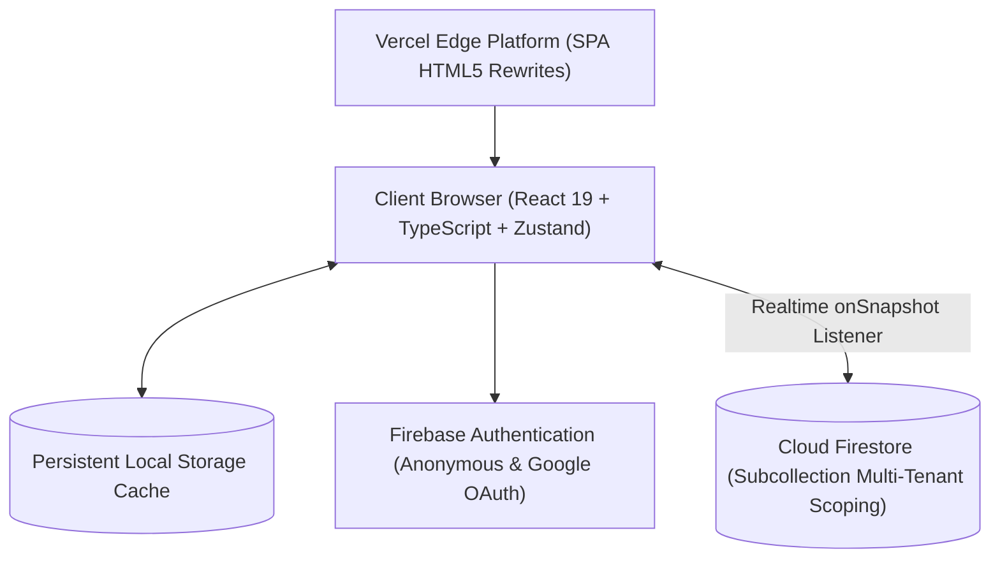

# StudyFlow — Deadlines, Timetable, Focus Timer & GPA What-If

[](https://app-beta-lilac-23.vercel.app)
[](https://app-beta-lilac-23.vercel.app)
[](https://react.dev)
[](https://www.typescriptlang.org)
[](https://tailwindcss.com)
[](https://firebase.google.com)
[](https://vitest.dev)

StudyFlow is a study planner for university students: assignments with subtasks, a weekly timetable, a Pomodoro focus timer with ambient sounds, a projected-GPA what-if calculator, and JSON backup/restore.

🔗 **Live Production URL**: [https://app-beta-lilac-23.vercel.app](https://app-beta-lilac-23.vercel.app)

---

## 📖 Table of Contents
- [About The Project](#-about-the-project)
- [System Architecture](#-system-architecture)
- [Key Features](#-key-features)
- [Technology Stack](#-technology-stack)
- [Getting Started](#-getting-started)
- [Testing & Quality Assurance](#-testing--quality-assurance)
- [Security & Multi-Tenant Isolation](#-security--multi-tenant-isolation)
- [Implementation Roadmap](#-implementation-roadmap)
- [Team & Governance](#-team--governance)

---

## 🎯 About The Project

University students routinely juggle complex syllabi, overlapping course deadlines, and fragmented study habits. StudyFlow provides a cohesive, single-window academic workspace designed with human-computer interaction (HCI) principles:
- **Low Cognitive Overhead**: Clean visual hierarchy that surfaces urgent obligations without artificial badges or high-stress neon pills.
- **Dual-Token Theme**: High-contrast paper palette for daylight library study and true dark obsidian slate for late-night focus sessions.
- **Timestamp-Anchored Timer**: Remaining time is recomputed from timestamps when the tab regains focus. Alerts do not fire while the device is asleep.
- **Dynamic GPA Simulator**: Course-weighted quality points calculation with a what-if solver computing exact needed exam percentages to secure target honors tiers.
- **Client-First Disaster Recovery**: JSON export and schema-validated import with prototype-pollution checks.

---

## 🏗️ System Architecture



---

## ✨ Key Features

1. **Today**: Upcoming deadlines, focus time, and a projected GPA.
2. **Coursework & Deliverables Tracker**: Comprehensive task management with subtask state machines, priority tiers, course code tags, and automatic progress calculation capped at 99% until fully verified.
3. **Weekly Academic Timetable**: Interactive schedule grid supporting lecture sessions, labs, review blocks, and exam periods with full quick-add modals and iCal ICS export.
4. **Deep Focus Timer & Soundscapes**: Configurable Pomodoro engine (Focus, Short Break, Long Break) paired with Web Audio API generative soundscapes (Rain, Brown noise, White noise, Binaural alpha beats).
5. **Academic Grades & What-If Simulator**: Standard 4.0 GPA calculation weighted by course credit hours. Includes an interactive solver that computes the exact final exam score needed to achieve target grades.
6. **Data Portability & Security**: Offline disaster recovery JSON backup with strict validation against prototype pollution and resource exhaustion.

---

## 💻 Technology Stack

- **Frontend Core**: [React 19](https://react.dev), [TypeScript 7](https://www.typescriptlang.org), [Vite 8](https://vitejs.dev)
- **Styling & UI**: [Tailwind CSS 3.4](https://tailwindcss.com), [Lucide React](https://lucide.dev)
- **State Management**: [Zustand 5](https://zustand-demo.pmnd.rs) with persistent local storage middleware
- **Backend & Cloud Sync**: [Firebase 13](https://firebase.google.com) (Authentication + Cloud Firestore)
- **Automated Testing**: [Vitest 5.1](https://vitest.dev)
- **Hosting & Edge Routing**: [Vercel](https://vercel.com) Edge Platform

---

## 🚀 Getting Started

### Prerequisites
- Node.js `v20.x` or higher
- npm `v10.x` or higher

### Local Development Setup

1. **Clone the repository**:
   ```bash
   git clone https://github.com/j-derek/studyflow.git
   cd studyflow/app
   ```

2. **Install dependencies**:
   ```bash
   npm install
   ```

3. **Configure Environment Variables**:
   Create a `.env.local` file with your Firebase configuration:
   ```env
   VITE_FIREBASE_API_KEY=your-api-key
   VITE_FIREBASE_AUTH_DOMAIN=your-project.firebaseapp.com
   VITE_FIREBASE_PROJECT_ID=your-project-id
   VITE_FIREBASE_STORAGE_BUCKET=your-project.appspot.com
   VITE_FIREBASE_MESSAGING_SENDER_ID=your-sender-id
   VITE_FIREBASE_APP_ID=your-app-id
   ```

4. **Launch development server**:
   ```bash
   npm run dev
   ```
   Open `http://localhost:5173` in your browser.

5. **Production Build**:
   ```bash
   npm run build
   ```

---

## 🧪 Testing & Quality Assurance

### Run Unit Test Suites
```bash
npm test
```
Runs the Vitest unit suites:
- `academicCalculations.test.ts`: GPA math, credit hour weighting, monotonicity, and what-if score boundary checks.
- `subtasks.test.ts`: Subtask progress state machine and the 99% cap invariant.
- `backupValidator.test.ts`: Prototype pollution injection defense and schema boundaries.

### Automated Browser E2E & Touch Target Audit
```bash
node scripts/run_phase4c_qa_audit.js
```
Validates cold-load console error count (`0`), verifies mobile touch target bounds ($\ge 44 \times 44\text{px}$) across all 28 interactive elements, and saves responsive snapshots to `qa-screenshots/`.

---

## 🔒 Security & Multi-Tenant Isolation

StudyFlow enforces enterprise multi-tenant isolation:
- **Subcollection Scoping**: All user data is nested exclusively under `/users/{userId}/` with Firestore rules verifying `request.auth.uid == userId`.
- **Focus session history**: Updates are denied by the rules. Forged *creates* are not yet constrained; this is tracked as Phase 4A work and is not claimed as protection.
- **Sign-out**: Unsubscribes Firestore listeners and resets the in-memory store. Clearing the Firestore IndexedDB cache is Phase 4A work and not yet done.
- **Client-Side Sanitization**: All JSON imports are validated against schema boundaries, maximum item quotas ($\le 1000$ assignments), and prototype pollution vectors.

---

## 🗺️ Implementation Roadmap

- [x] **Phase 1: Production MVP** — Deployed live on Vercel.
- [x] **Phase 2: UI/UX Audit & Anti-Slop Redesign** — Neutralized AI fingerprints, unified dual-token styling.
- [x] **Phase 3: Front-End Remediations** — Real editable student profiles, week-switching schedule, What-If simulator, and responsive navigation.
- [ ] **Phase 4A: Backend Hardening & Automated Test Suites** — in progress: Firestore rules emulator suite, account-switch isolation tests, pure-logic tests, CI.
- [ ] **Phase 4B: Vercel preview (4B-1) and production domain (4B-2)** — the app is live on a `vercel.app` URL; no custom domain bound yet.
- [ ] **Phase 4C: Multi-Device QA & Accessibility Audit** — 0 console errors, mobile touch targets verified; full axe-core audit scheduled.
- [x] **Phase 5: GitHub Push & Release Tagging** — Synchronized to [github.com/J-Derek/studyflow](https://github.com/J-Derek/studyflow).

---

## 👥 Team & Governance

- **Product Owner**: 21
- **Built with AI coding assistants; every change is reviewed by the product owner
