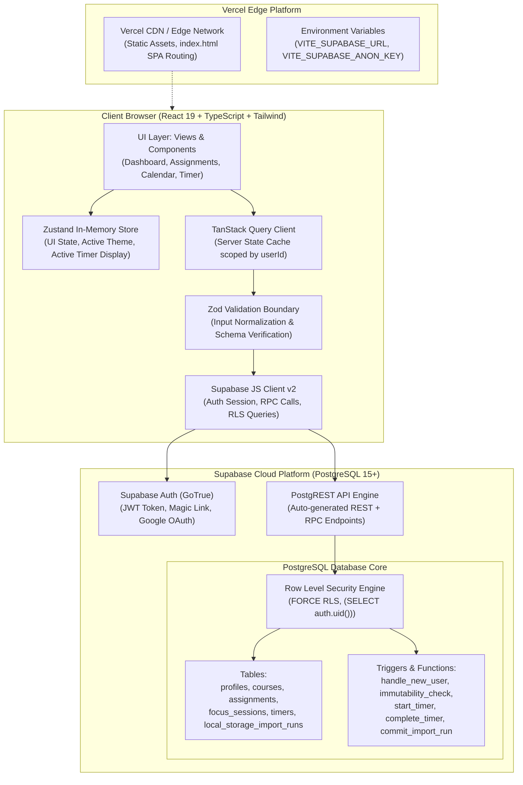
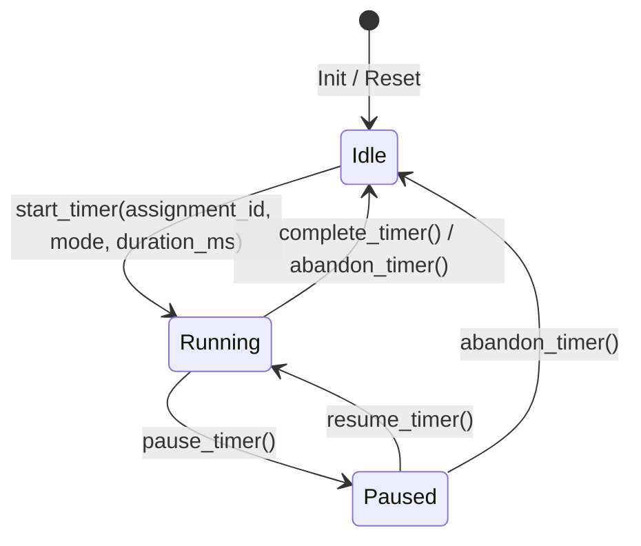

# StudyFlow — System Architecture Specification

**Document Version**: 2.0.0  
**Phase**: Phase 2 — Production Hardening & Cloud Backend  
**Status**: Architecture Baseline Approved  
**Last Updated**: November 2026  

---

## 1. System Topology & Architectural Overview

StudyFlow operates as a modern cloud-backed Single Page Application (SPA). The frontend is built on **React 19**, **TypeScript**, and **Vite**, served globally from Vercel's Edge Network. The backend layer is powered by **Supabase**, providing managed **PostgreSQL 15+**, **GoTrue Authentication**, and **PostgREST** with hardware-enforced **Row Level Security (RLS)**.



---

## 2. Layered Frontend Architecture

```
studyflow/app/src/
├── domain/                    # Pure Domain Logic & Types (Framework-agnostic)
│   ├── time.ts                # Timezone calculations, DST handling, wall-clock helpers
│   ├── status.ts              # Derived assignment status and progress evaluation
│   └── timer.ts               # Timer state machine, millisecond arithmetic
├── lib/                       # External Client Integrations & Core Infrastructure
│   ├── supabase.ts            # Supabase JS client singleton with auth listener
│   ├── queryClient.ts         # TanStack Query instance with user isolation & error handling
│   └── validation/            # Zod validation schemas for all domain entities
│       ├── course.schema.ts
│       ├── assignment.schema.ts
│       ├── timer.schema.ts
│       └── migration.schema.ts
├── store/                     # Zustand State Stores (UI State Only)
│   ├── uiStore.ts             # Active navigation tab, modal open states, sidebar toggle
│   └── themeStore.ts          # Light, dark, system theme toggle & DOM class sync
├── hooks/                     # Custom React Hooks & Data Access
│   ├── useAuth.ts             # User session, login, logout, profile state
│   ├── useAssignments.ts      # TanStack Query queries & mutations for assignments
│   ├── useCourses.ts          # TanStack Query queries & mutations for courses
│   ├── useTimer.ts            # High-precision timer hook with server offset calibration
│   └── useMigration.ts        # LocalStorage import workflow & ledger verification
└── components/                # Modular UI Components (Accessible & Responsive)
    ├── layout/                # AppShell, NavigationSidebar, TopHeader, OfflineBanner
    ├── dashboard/             # StatCards, UrgentAssignments, TodaySchedule
    ├── assignments/           # AssignmentList, AssignmentCard, AssignmentModal
    ├── calendar/              # WeeklyTimeGrid, CalendarEventCard
    ├── timer/                 # TimerDisplayRing, TimerControls, SessionHistory
    └── ui/                    # Base primitives (Button, Modal, Input, Badge, Slider)
```

---

## 3. Data Flow & State Management Principles

### 3.1 Server State vs. Client UI State Separation
- **Server State (Managed by TanStack Query)**:
  - Courses, assignments, study sessions, focus history, import ledger.
  - Query keys are strictly namespaced by user ID: `['user', userId, 'assignments']`.
  - Revalidation is automatic upon window focus and mutation success.
- **Client UI State (Managed by Zustand)**:
  - Sidebar collapse/expansion, active filter selections, modal visibility, theme mode.
  - Zero academic entities or student records are stored permanently in Zustand, eliminating stale state desynchronization.

### 3.2 Five-Point Client Cache Isolation Protocol
On sign-out or when an active user session transitions to a different user, the client executes a mandatory 5-point purge:
1. **In-Flight Network Requests**: Call `queryClient.cancelQueries()`.
2. **TanStack Query Cache**: Call `queryClient.clear()` to empty all cached queries.
3. **Zustand Store**: Reset all stores to initial blank state (`useUIStore.getState().reset()`).
4. **LocalStorage Isolation**: Clear user-namespaced storage keys (`studyflow_${userId}_*`).
5. **Realtime Channels & Active Timers**: Call `supabase.removeAllChannels()`, cancel pending `setTimeout` intervals, and remove `visibilitychange` listeners.

---

## 4. Server-Authoritative Timer Architecture

To resolve the timer drift and tab-backgrounding defects identified in Phase 1, the timer operates as a **server-authoritative finite state machine**:



### 4.1 Timer Invariants & Precision
1. **Clock Authority**: All state transitions (`start_timer`, `pause_timer`, `resume_timer`, `complete_timer`) execute as PostgreSQL stored procedures utilizing `now()`.
2. **Microsecond Precision**: Durations are calculated and stored in milliseconds (`remaining_ms`), completely eliminating the 1-second rounding error of legacy timers.
3. **Drift Immunity**: While `phase = 'running'`, `ends_at` is an immutable timestamp. The client display computes:
   $$\text{Remaining} = \max(0, \text{ends\_at} - (\text{ClientNow} + \text{ClockOffset}))$$
   Closing the laptop, sleeping the OS, or switching tabs causes zero drift.

---

## 5. Offline & Network Resiliency Architecture

- **Strategy**: Online-first with read-only cached browsing.
- **Offline Detection**: Monitored via `navigator.onLine` and window `online` / `offline` event listeners.
- **Offline Experience**:
  - Global banner: *"Offline Mode — Viewing cached study data. Edits are disabled until your connection is restored."*
  - Read actions: TanStack Query serves previously cached data from memory.
  - Write actions: Creation, edit, and delete buttons are disabled with descriptive tooltips, preventing unacknowledged mutation loss.
  - Reconnection: Upon reconnecting, TanStack Query automatically triggers background revalidation of all active queries.

---

## 6. Threat Model & Security Architecture

1. **Hardware-Enforced RLS**: Every PostgreSQL table enforces `ENABLE ROW LEVEL SECURITY` and `FORCE ROW LEVEL SECURITY`.
2. **Composite Foreign Keys**: All child tables (`assignments`, `focus_sessions`, `calendar_blocks`) enforce composite foreign keys referencing `(user_id, parent_id)`, making cross-user reference attacks structurally impossible at the engine level.
3. **Ownership Immutability**: A PostgreSQL `BEFORE UPDATE` trigger rejects any attempt to modify `user_id` on any table.
4. **Credential Isolation**: Only `VITE_SUPABASE_ANON_KEY` is bundled in the client. The administrative `SUPABASE_SERVICE_ROLE_KEY` is strictly prohibited from client bundles and build scripts.
5. **PostgREST Query Limits**: SQL views and aggregation RPCs are used for analytics, preventing PostgREST's default 1,000-row limit from truncating student productivity metrics.
