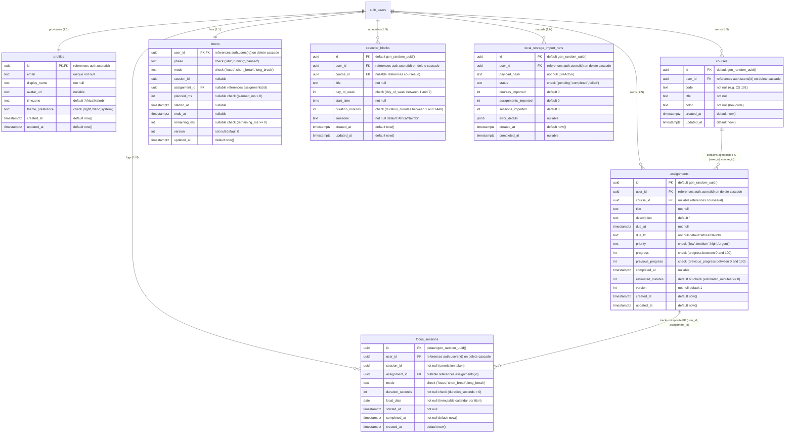

# StudyFlow — Database Schema & Data Definition (DDL)

**Document Version**: 2.2.1 (Hardened & Reconciled with TIMER-SPEC v2.5.0)  
**Target Engine**: PostgreSQL 15+ (Supabase Managed PostgreSQL)  
**Status**: Architecture Baseline Approved — Verification Grade (Task 009-C)  
**Last Updated**: November 2026  

---

## 1. Entity-Relationship Diagram (ERD)



---

## 2. Complete PostgreSQL 15+ Production Schema DDL

```sql
-- =============================================================================
-- StudyFlow Phase 2 Production Database Schema (DDL)
-- Version 2.2.0 — Hardened Multi-Tenancy, Composite Keys & RLS
-- Target: PostgreSQL 15+ (Supabase Managed PostgreSQL)
-- =============================================================================

-- Enable essential extensions
CREATE EXTENSION IF NOT EXISTS "uuid-ossp";
CREATE EXTENSION IF NOT EXISTS "pgcrypto";

-- -----------------------------------------------------------------------------
-- 1. PROFILES (1:1 with auth.users)
-- -----------------------------------------------------------------------------
CREATE TABLE public.profiles (
    id UUID PRIMARY KEY REFERENCES auth.users(id) ON DELETE CASCADE,
    email TEXT UNIQUE NOT NULL,
    display_name TEXT NOT NULL,
    avatar_url TEXT,
    timezone TEXT NOT NULL DEFAULT 'Africa/Nairobi',
    theme_preference TEXT NOT NULL DEFAULT 'system' CHECK (theme_preference IN ('light', 'dark', 'system')),
    created_at TIMESTAMPTZ NOT NULL DEFAULT now(),
    updated_at TIMESTAMPTZ NOT NULL DEFAULT now(),
    CONSTRAINT chk_profile_display_name_len CHECK (char_length(display_name) BETWEEN 1 AND 100)
);

ALTER TABLE public.profiles ENABLE ROW LEVEL SECURITY;
ALTER TABLE public.profiles FORCE ROW LEVEL SECURITY;

-- -----------------------------------------------------------------------------
-- 2. COURSES
-- Composite target: UNIQUE (user_id, id)
-- -----------------------------------------------------------------------------
CREATE TABLE public.courses (
    id UUID PRIMARY KEY DEFAULT gen_random_uuid(),
    user_id UUID NOT NULL DEFAULT auth.uid() REFERENCES auth.users(id) ON DELETE CASCADE,
    code TEXT NOT NULL,
    title TEXT NOT NULL,
    color TEXT NOT NULL,
    created_at TIMESTAMPTZ NOT NULL DEFAULT now(),
    updated_at TIMESTAMPTZ NOT NULL DEFAULT now(),
    UNIQUE (user_id, id),
    CONSTRAINT chk_course_code_len CHECK (char_length(code) BETWEEN 1 AND 20),
    CONSTRAINT chk_course_title_len CHECK (char_length(title) BETWEEN 1 AND 150),
    CONSTRAINT chk_course_color_format CHECK (color ~ '^#([A-Fa-f0-9]{6})$')
);

CREATE INDEX idx_courses_user_id ON public.courses(user_id);
ALTER TABLE public.courses ENABLE ROW LEVEL SECURITY;
ALTER TABLE public.courses FORCE ROW LEVEL SECURITY;

-- -----------------------------------------------------------------------------
-- 3. ASSIGNMENTS
-- Composite FK: ON DELETE SET NULL (course_id) clears course_id, preserves user_id
-- Target composite constraint for focus_sessions: UNIQUE (user_id, id)
-- -----------------------------------------------------------------------------
CREATE TABLE public.assignments (
    id UUID PRIMARY KEY DEFAULT gen_random_uuid(),
    user_id UUID NOT NULL DEFAULT auth.uid() REFERENCES auth.users(id) ON DELETE CASCADE,
    course_id UUID,
    title TEXT NOT NULL,
    description TEXT NOT NULL DEFAULT '',
    due_at TIMESTAMPTZ NOT NULL,
    due_tz TEXT NOT NULL DEFAULT 'Africa/Nairobi',
    priority TEXT NOT NULL DEFAULT 'medium' CHECK (priority IN ('low', 'medium', 'high', 'urgent')),
    progress INT NOT NULL DEFAULT 0 CHECK (progress BETWEEN 0 AND 100),
    previous_progress INT NOT NULL DEFAULT 0 CHECK (previous_progress BETWEEN 0 AND 100),
    completed_at TIMESTAMPTZ,
    estimated_minutes INT NOT NULL DEFAULT 60 CHECK (estimated_minutes >= 0),
    version INT NOT NULL DEFAULT 1,
    created_at TIMESTAMPTZ NOT NULL DEFAULT now(),
    updated_at TIMESTAMPTZ NOT NULL DEFAULT now(),
    UNIQUE (user_id, id),
    FOREIGN KEY (user_id, course_id) REFERENCES public.courses(user_id, id) ON DELETE SET NULL (course_id),
    CONSTRAINT chk_assignment_title_len CHECK (char_length(title) BETWEEN 1 AND 200),
    CONSTRAINT chk_assignment_desc_len CHECK (char_length(description) <= 2000)
);

CREATE INDEX idx_assignments_user_id ON public.assignments(user_id);
CREATE INDEX idx_assignments_user_course ON public.assignments(user_id, course_id);
CREATE INDEX idx_assignments_due_at ON public.assignments(user_id, due_at);
ALTER TABLE public.assignments ENABLE ROW LEVEL SECURITY;
ALTER TABLE public.assignments FORCE ROW LEVEL SECURITY;

-- -----------------------------------------------------------------------------
-- 4. FOCUS SESSIONS (Logged historical study sessions)
-- Composite FK: ON DELETE SET NULL (assignment_id) clears assignment_id
-- -----------------------------------------------------------------------------
CREATE TABLE public.focus_sessions (
    id UUID PRIMARY KEY DEFAULT gen_random_uuid(),
    user_id UUID NOT NULL DEFAULT auth.uid() REFERENCES auth.users(id) ON DELETE CASCADE,
    session_id UUID NOT NULL,
    assignment_id UUID,
    mode TEXT NOT NULL CHECK (mode IN ('focus', 'short_break', 'long_break')),
    duration_seconds INT NOT NULL CHECK (duration_seconds > 0),
    duration_ms INT NOT NULL CHECK (duration_ms >= 60000 AND duration_ms <= 86400000),
    local_date DATE NOT NULL,
    started_at TIMESTAMPTZ NOT NULL,
    completed_at TIMESTAMPTZ NOT NULL DEFAULT now(),
    created_at TIMESTAMPTZ NOT NULL DEFAULT now(),
    UNIQUE (user_id, session_id),
    CONSTRAINT fk_focus_sessions_assignment FOREIGN KEY (user_id, assignment_id) REFERENCES public.assignments(user_id, id) ON DELETE SET NULL (assignment_id)
);

CREATE INDEX idx_focus_sessions_user_date ON public.focus_sessions(user_id, local_date);
CREATE INDEX idx_focus_sessions_user_assignment ON public.focus_sessions(user_id, assignment_id);
ALTER TABLE public.focus_sessions ENABLE ROW LEVEL SECURITY;
ALTER TABLE public.focus_sessions FORCE ROW LEVEL SECURITY;

-- -----------------------------------------------------------------------------
-- 5. TIMERS (Single canonical active timer per user with strict XOR state)
-- -----------------------------------------------------------------------------
CREATE TABLE public.timers (
    user_id UUID PRIMARY KEY DEFAULT auth.uid() REFERENCES auth.users(id) ON DELETE CASCADE,
    phase TEXT NOT NULL CHECK (phase IN ('idle', 'running', 'paused')),
    mode TEXT NOT NULL DEFAULT 'focus' CHECK (mode IN ('focus', 'short_break', 'long_break')),
    session_id UUID,
    assignment_id UUID,
    snapshot_tz TEXT,
    planned_ms INT CHECK (planned_ms BETWEEN 60000 AND 86400000), -- 1 min to 24 hrs
    started_at TIMESTAMPTZ,
    ends_at TIMESTAMPTZ,
    remaining_ms INT CHECK (remaining_ms > 0 AND remaining_ms <= planned_ms),
    version INT NOT NULL DEFAULT 0 CHECK (version >= 0),
    updated_at TIMESTAMPTZ NOT NULL DEFAULT now(),
    -- assignment_id is an ephemeral in-flight reference validated via EXISTS in start_timer.
    -- Database-level FK is intentionally decoupled from timers to eliminate implicit RI_FKey lock
    -- inversion cycles with concurrent DELETE FROM assignments. Authoritative FK is on focus_sessions.
    CONSTRAINT chk_timer_strict_xor_state CHECK (
        (phase = 'idle'    AND session_id IS NULL     AND ends_at IS NULL     AND remaining_ms IS NULL     AND started_at IS NULL     AND planned_ms IS NULL     AND assignment_id IS NULL AND snapshot_tz IS NULL) OR
        (phase = 'running' AND session_id IS NOT NULL AND ends_at IS NOT NULL AND remaining_ms IS NULL     AND started_at IS NOT NULL AND planned_ms IS NOT NULL AND snapshot_tz IS NOT NULL) OR
        (phase = 'paused'  AND session_id IS NOT NULL AND ends_at IS NULL     AND remaining_ms IS NOT NULL AND started_at IS NOT NULL AND planned_ms IS NOT NULL AND snapshot_tz IS NOT NULL)
    )
);

ALTER TABLE public.timers ENABLE ROW LEVEL SECURITY;
ALTER TABLE public.timers FORCE ROW LEVEL SECURITY;

-- -----------------------------------------------------------------------------
-- 6. CALENDAR BLOCKS (Weekly recurring study schedule; ISO weekday 1=Mon, 7=Sun)
-- -----------------------------------------------------------------------------
CREATE TABLE public.calendar_blocks (
    id UUID PRIMARY KEY DEFAULT gen_random_uuid(),
    user_id UUID NOT NULL DEFAULT auth.uid() REFERENCES auth.users(id) ON DELETE CASCADE,
    course_id UUID,
    title TEXT NOT NULL,
    day_of_week INT NOT NULL CHECK (day_of_week BETWEEN 1 AND 7),
    start_time TIME NOT NULL,
    duration_minutes INT NOT NULL CHECK (duration_minutes BETWEEN 1 AND 1440),
    timezone TEXT NOT NULL DEFAULT 'Africa/Nairobi',
    created_at TIMESTAMPTZ NOT NULL DEFAULT now(),
    updated_at TIMESTAMPTZ NOT NULL DEFAULT now(),
    FOREIGN KEY (user_id, course_id) REFERENCES public.courses(user_id, id) ON DELETE SET NULL (course_id),
    CONSTRAINT chk_cal_title_len CHECK (char_length(title) BETWEEN 1 AND 150)
);

CREATE INDEX idx_calendar_blocks_user ON public.calendar_blocks(user_id, day_of_week);
ALTER TABLE public.calendar_blocks ENABLE ROW LEVEL SECURITY;
ALTER TABLE public.calendar_blocks FORCE ROW LEVEL SECURITY;

-- -----------------------------------------------------------------------------
-- 7. LOCAL STORAGE IMPORT RUNS (Migration Ledger)
-- -----------------------------------------------------------------------------
CREATE TABLE public.local_storage_import_runs (
    id UUID PRIMARY KEY DEFAULT gen_random_uuid(),
    user_id UUID NOT NULL DEFAULT auth.uid() REFERENCES auth.users(id) ON DELETE CASCADE,
    payload_hash TEXT NOT NULL,
    status TEXT NOT NULL DEFAULT 'pending' CHECK (status IN ('pending', 'completed', 'failed')),
    courses_imported INT NOT NULL DEFAULT 0,
    assignments_imported INT NOT NULL DEFAULT 0,
    sessions_imported INT NOT NULL DEFAULT 0,
    error_details JSONB,
    created_at TIMESTAMPTZ NOT NULL DEFAULT now(),
    completed_at TIMESTAMPTZ,
    UNIQUE (user_id, payload_hash)
);

CREATE INDEX idx_import_runs_user ON public.local_storage_import_runs(user_id);
ALTER TABLE public.local_storage_import_runs ENABLE ROW LEVEL SECURITY;
ALTER TABLE public.local_storage_import_runs FORCE ROW LEVEL SECURITY;

-- -----------------------------------------------------------------------------
-- 8. TRIGGERS: Ownership Immutability & Updated Timestamps
-- -----------------------------------------------------------------------------
CREATE OR REPLACE FUNCTION public.fn_prevent_user_id_change()
RETURNS TRIGGER AS $$
BEGIN
    IF NEW.user_id IS DISTINCT FROM OLD.user_id THEN
        RAISE EXCEPTION 'Ownership modification prohibited: user_id is immutable';
    END IF;
    NEW.updated_at = now();
    RETURN NEW;
END;
$$ LANGUAGE plpgsql SECURITY DEFINER SET search_path = '';

CREATE TRIGGER trg_courses_immutability
    BEFORE UPDATE ON public.courses
    FOR EACH ROW EXECUTE FUNCTION public.fn_prevent_user_id_change();

CREATE TRIGGER trg_assignments_immutability
    BEFORE UPDATE ON public.assignments
    FOR EACH ROW EXECUTE FUNCTION public.fn_prevent_user_id_change();

CREATE TRIGGER trg_calendar_blocks_immutability
    BEFORE UPDATE ON public.calendar_blocks
    FOR EACH ROW EXECUTE FUNCTION public.fn_prevent_user_id_change();

-- Timezone Serialization: Prohibit profile timezone mutations while a timer is active
CREATE OR REPLACE FUNCTION public.fn_prevent_active_timer_tz_change()
RETURNS TRIGGER AS $$
DECLARE
    v_phase TEXT;
BEGIN
    IF NEW.timezone IS DISTINCT FROM OLD.timezone THEN
        SELECT phase INTO v_phase FROM public.timers WHERE user_id = NEW.id FOR UPDATE;
        IF v_phase IS NOT NULL AND v_phase != 'idle' THEN
            RAISE EXCEPTION 'ACTIVE_TIMER_EXISTS: Cannot change profile timezone while a timer is active.'
                USING ERRCODE = 'P0001',
                      DETAIL = 'ACTIVE_TIMER_EXISTS',
                      HINT = 'Complete or abandon the currently active timer session before modifying timezone.';
        END IF;
    END IF;
    RETURN NEW;
END;
$$ LANGUAGE plpgsql SECURITY DEFINER SET search_path = '';

CREATE TRIGGER trg_profiles_tz_lock
    BEFORE UPDATE OF timezone ON public.profiles
    FOR EACH ROW EXECUTE FUNCTION public.fn_prevent_active_timer_tz_change();

-- -----------------------------------------------------------------------------
-- 9. TRIGGERS: Automated Profile Provisioning on auth.users Creation
-- Wrapped in exception isolation to protect primary authentication flow
-- -----------------------------------------------------------------------------
CREATE OR REPLACE FUNCTION public.handle_new_user()
RETURNS TRIGGER AS $$
BEGIN
    INSERT INTO public.profiles (id, email, display_name, avatar_url, timezone)
    VALUES (
        NEW.id,
        NEW.email,
        COALESCE(NEW.raw_user_meta_data->>'full_name', split_part(NEW.email, '@', 1)),
        NEW.raw_user_meta_data->>'avatar_url',
        'Africa/Nairobi'
    )
    ON CONFLICT (id) DO NOTHING;

    INSERT INTO public.timers (user_id, phase, mode)
    VALUES (NEW.id, 'idle', 'focus')
    ON CONFLICT (user_id) DO NOTHING;

    RETURN NEW;
EXCEPTION WHEN OTHERS THEN
    RAISE WARNING 'handle_new_user failed for user %: %', NEW.id, SQLERRM;
    RETURN NEW;
END;
$$ LANGUAGE plpgsql SECURITY DEFINER SET search_path = '';

CREATE TRIGGER on_auth_user_created
    AFTER INSERT ON auth.users
    FOR EACH ROW EXECUTE FUNCTION public.handle_new_user();

-- -----------------------------------------------------------------------------
-- 10. POSTGREST ROW-CAP MITIGATION VIEWS (security_invoker = true)
-- -----------------------------------------------------------------------------
CREATE OR REPLACE VIEW public.v_user_focus_stats
WITH (security_invoker = true) AS
SELECT
    user_id,
    COUNT(*) FILTER (WHERE mode = 'focus') AS total_focus_sessions,
    COALESCE(SUM(duration_seconds) FILTER (WHERE mode = 'focus'), 0) / 60 AS total_focus_minutes,
    COUNT(DISTINCT local_date) FILTER (WHERE mode = 'focus') AS active_study_days
FROM public.focus_sessions
GROUP BY user_id;

-- -----------------------------------------------------------------------------
-- 11. RPC: repair_profile (Idempotent Profile & Timer Repair for Client)
-- -----------------------------------------------------------------------------
CREATE OR REPLACE FUNCTION public.repair_profile()
RETURNS public.profiles AS $$
DECLARE
    v_uid UUID := (SELECT auth.uid());
    v_profile public.profiles;
    v_email TEXT;
BEGIN
    IF v_uid IS NULL THEN
        RAISE EXCEPTION 'Authentication required';
    END IF;

    SELECT email INTO v_email FROM auth.users WHERE id = v_uid;

    INSERT INTO public.profiles (id, email, display_name, timezone)
    VALUES (v_uid, v_email, split_part(v_email, '@', 1), 'Africa/Nairobi')
    ON CONFLICT (id) DO UPDATE SET updated_at = now()
    RETURNING * INTO v_profile;

    INSERT INTO public.timers (user_id, phase, mode)
    VALUES (v_uid, 'idle', 'focus')
    ON CONFLICT (user_id) DO NOTHING;

    RETURN v_profile;
END;
$$ LANGUAGE plpgsql SECURITY DEFINER SET search_path = '';

-- -----------------------------------------------------------------------------
-- 12. SECURITY DEFINER RPCs (Authoritative Definitions in TIMER-SPEC.md v2.6.0)
-- -----------------------------------------------------------------------------
-- All timer state machine mutations and timezone serialization are governed strictly
-- by TIMER-SPEC.md v2.6.0 and API-SPEC.md v2.6.0 returning JSONB two-channel response envelopes:
-- 1. start_timer(p_planned_ms INT, p_mode TEXT, p_assignment_id UUID)
-- 2. pause_timer()
-- 3. resume_timer()
-- 4. complete_timer(p_session_id UUID)
-- 5. abandon_timer(p_session_id UUID)
-- 6. sync_timer()
-- 7. update_profile_timezone(p_timezone TEXT)

-- -----------------------------------------------------------------------------
-- 13. ROLE PRIVILEGES & HARDENED PER-FUNCTION EXECUTE GRANTS
-- Helper functions (fn_prevent_user_id_change, handle_new_user) are REVOKED from all client roles
-- -----------------------------------------------------------------------------
REVOKE ALL ON ALL TABLES IN SCHEMA public FROM anon, PUBLIC;
REVOKE ALL ON ALL SEQUENCES IN SCHEMA public FROM anon, PUBLIC;
REVOKE ALL ON ALL FUNCTIONS IN SCHEMA public FROM anon, PUBLIC;

-- Explicit Least-Privilege Table Grants to authenticated (Zero blanket table grants)
GRANT SELECT, INSERT, UPDATE, DELETE ON public.courses TO authenticated;
GRANT SELECT, INSERT, UPDATE, DELETE ON public.assignments TO authenticated;
GRANT SELECT, INSERT, UPDATE, DELETE ON public.calendar_blocks TO authenticated;
GRANT SELECT, INSERT, UPDATE ON public.local_storage_import_runs TO authenticated;

-- Profiles: SELECT granted; UPDATE granted strictly on non-timezone columns
GRANT SELECT ON public.profiles TO authenticated;
GRANT UPDATE (display_name, avatar_url, theme_preference, updated_at) ON public.profiles TO authenticated;

-- Historical Sessions & Timers: SELECT only (mutations strictly via SECURITY DEFINER RPCs)
GRANT SELECT ON public.focus_sessions TO authenticated;
GRANT SELECT ON public.timers TO authenticated;

GRANT USAGE, SELECT ON ALL SEQUENCES IN SCHEMA public TO authenticated;

-- Explicit per-function grants exclusively to authenticated role (7 core RPCs + repair_profile)
GRANT EXECUTE ON FUNCTION public.start_timer(INT, TEXT, UUID) TO authenticated;
GRANT EXECUTE ON FUNCTION public.pause_timer() TO authenticated;
GRANT EXECUTE ON FUNCTION public.resume_timer() TO authenticated;
GRANT EXECUTE ON FUNCTION public.complete_timer(UUID) TO authenticated;
GRANT EXECUTE ON FUNCTION public.abandon_timer(UUID) TO authenticated;
GRANT EXECUTE ON FUNCTION public.sync_timer() TO authenticated;
GRANT EXECUTE ON FUNCTION public.update_profile_timezone(TEXT) TO authenticated;
GRANT EXECUTE ON FUNCTION public.repair_profile() TO authenticated;
```
